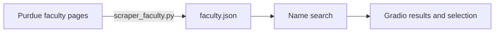

# Purdue ECE Faculty Finder

Find Purdue ECE faculty by name and explore their research interests, personal websites, and contact information in a small Gradio app.

The repository includes a **134-record faculty snapshot**, so searching works locally without scraping or API keys. A separate scraper refreshes the snapshot from Purdue’s public faculty pages.

## Try it locally

Use Python 3.10 or later. Dependencies pin Gradio 5.35.0 for the app’s launch API.

```bash
git clone https://github.com/sudhanvad18/CPP_SWE.git
cd CPP_SWE
python3 -m venv .venv
source .venv/bin/activate
python -m pip install -r requirements.txt
PORT=7860 python app.py
```

Open **http://localhost:7860**. On Windows, activate the environment with `.venv\Scripts\activate` and set `PORT` using your shell’s environment-variable syntax. Without `PORT`, the app uses port `10000`.

Enter a partial or full name, such as `love`, and press Enter or select **Search**:

- A single match opens its details immediately.
- Multiple matches appear in a selection menu.
- Empty searches and missing names produce an explanatory message.

The search ignores capitalization and uses substring matching. Research and contact fields come from the bundled snapshot and may change over time.

## How it works



`app.py` loads `faculty.json` once at startup. The interface searches names and renders faculty information; it does not make live requests during a search. Output text is HTML-escaped before presentation.

## Refresh the data

Run this separately from the app when an updated snapshot is needed:

```bash
python scraper_faculty.py
```

The scraper uses Requests and BeautifulSoup to read [Purdue’s ECE faculty directory](https://engineering.purdue.edu/ECE/People/Faculty) and individual faculty pages. It overwrites `faculty.json`; restart the app to load the updated file. Its selectors depend on the source website’s markup.

## Repository map

| File | Purpose |
| --- | --- |
| `app.py` | Search callbacks, faculty details, and Gradio interface. |
| `scraper_faculty.py` | Directory/profile extraction and JSON export. |
| `faculty.json` | Bundled faculty data used by the app. |
| `requirements.txt` | Python dependencies, including the verified Gradio version. |
| `Procfile` | Process command for environments that provide `PORT`. |
